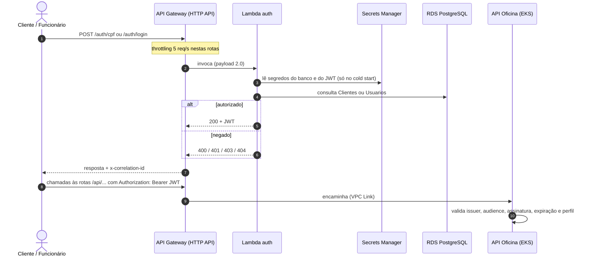

# oficina-lambda-auth

Functions serverless (AWS Lambda, .NET 8) da oficina:

- **Autenticação do cliente por CPF** (`POST /auth/cpf`): valida o CPF, consulta existência e status do cliente e devolve um **JWT** para as rotas protegidas.
- **Login de funcionário** (`POST /auth/login`): usuário e senha de admin ou atendente, com o perfil e a loja no token.
- **Inativação de clientes** (agendada, diária): aplica a política de inatividade do ADR-005.

Repositório 1 de 4 do Tech Challenge da Fase 3 (SOAT):

| Repositório | Conteúdo |
| --- | --- |
| **oficina-lambda-auth** (este) | Lambdas de autenticação e job de inativação + rotas no API Gateway |
| oficina-infra-k8s | VPC, cluster EKS, API Gateway, segredo do JWT, SNS |
| oficina-infra-db | RDS PostgreSQL e segredos do banco |
| [tech-challenge-oficina-mecanica](https://github.com/menta2010/tech-challenge-oficina-mecanica) | API de ordens de serviço rodando no Kubernetes |

## Links

| Item | Link |
| --- | --- |
| Autenticação por CPF (prod) | `POST https://7d2ypan7l9.execute-api.us-east-1.amazonaws.com/auth/cpf` |
| Login de funcionário (prod) | `POST https://7d2ypan7l9.execute-api.us-east-1.amazonaws.com/auth/login` |
| Swagger | https://7d2ypan7l9.execute-api.us-east-1.amazonaws.com/swagger |
| Collection Postman | [oficina-fase3.postman_collection.json](https://github.com/menta2010/tech-challenge-oficina-mecanica/blob/master/docs/postman/oficina-fase3.postman_collection.json) |

O ambiente roda no AWS Academy: a URL só responde enquanto o laboratório está ligado.

## Autenticação por CPF — `POST /auth/cpf`

1. Recebe `{"cpf": "529.982.247-25"}` (com ou sem máscara).
2. Valida os dígitos verificadores (mesma regra do cadastro de clientes da API).
3. Consulta o cliente na tabela `Clientes` do PostgreSQL (existência e coluna `Ativo`).
4. Emite um JWT HS256 com o **mesmo issuer, audience e chave** que a API valida: `role = Cliente`, `sub` = id do cliente, `cpf`.

| Situação | HTTP | Corpo |
| --- | --- | --- |
| CPF válido, cliente ativo | 200 | `token`, `tipo`, `expiraEm`, `cliente {id, nome}` |
| CPF inválido ou corpo malformado | 400 | `{"erro": "..."}` |
| Cliente inativo | 403 | `{"erro": "Cliente inativo."}` |
| Cliente não encontrado | 404 | `{"erro": "Cliente nao encontrado."}` |
| Falha inesperada | 500 | `{"erro": "Erro interno ao autenticar."}` |

## Login de funcionário — `POST /auth/login`

Recebe `{"usuario": "atendente.centro", "senha": "..."}`, confere o hash PBKDF2 (o mesmo formato gravado pela API) na tabela `Usuarios` e emite um JWT com `role = Admin | Atendente` e, para atendentes, `loja_id`. Usuário inexistente e senha errada recebem a **mesma** resposta 401, para não revelar quais usuários existem.

## Job de inativação — `InativacaoClientesFunction`

Disparado pelo EventBridge todo dia às 06:00 UTC. Inativa clientes **criados há mais de 24 meses, sem OS nos últimos 24 meses e sem nenhuma OS em andamento**; o prazo vem de `MESES_INATIVIDADE`. É uma única instrução `UPDATE`, idempotente, validada contra o schema real das migrations. Quando o cliente volta e um funcionário abre uma nova OS para ele, a API o reativa.

## Arquitetura



As Lambdas rodam **dentro da VPC**, nas subnets privadas, com o security group `oficina-<ambiente>-db-clients`, o único liberado no RDS. O banco nunca fica exposto na internet.

### Contrato com os outros repositórios

O Terraform deste repositório **não cria** a rede, o banco nem o API Gateway: ele os encontra por nome ou tag.

| Recurso | Nome ou tag esperada | Criado em |
| --- | --- | --- |
| VPC | tag `Name = oficina-<ambiente>-vpc` | oficina-infra-k8s |
| Subnets privadas | tag `Tier = private` | oficina-infra-k8s |
| API Gateway HTTP | `oficina-<ambiente>-api` | oficina-infra-k8s |
| Segredo do JWT | `oficina/<ambiente>/jwt` (texto, mín. 32 caracteres) | oficina-infra-k8s |
| Security group de acesso ao banco | `oficina-<ambiente>-db-clients` | oficina-infra-db |
| Segredo do banco | `oficina/<ambiente>/db` (JSON `host`, `port`, `dbname`, `username`, `password`) | oficina-infra-db |

**Ordem de deploy:** infra-k8s → infra-db → lambda-auth → app.

## Observabilidade

- Logs em **JSON estruturado**, uma linha por evento, com `correlationId`. Ele vem do header `x-correlation-id` ou, se não houver, do `requestId` do API Gateway, e volta na resposta para ser propagado à API.
- CPF nunca aparece em claro no log (`***.***.***-25`).
- Logs no CloudWatch (`/aws/lambda/oficina-<ambiente>-*`, retenção de 7 dias), encaminhados ao New Relic pela integração AWS; métricas de invocações, erros e duração também vão para o New Relic e alimentam o alerta "Erros na Lambda de autenticação".

## Tecnologias

.NET 8 · AWS Lambda (runtime `dotnet8`) · Amazon API Gateway (HTTP API) · Amazon EventBridge · AWS Secrets Manager · Amazon RDS PostgreSQL (Npgsql) · JWT (System.IdentityModel.Tokens.Jwt) · PBKDF2 · Terraform · GitHub Actions · xUnit + FluentAssertions

## Estrutura

```
src/Oficina.Auth.Lambda/
  Function.cs                  entrada HTTP (/auth/cpf e /auth/login)
  AutenticacaoCpf.cs           caso de uso do cliente
  AutenticacaoFuncionario.cs   caso de uso do funcionário + verificação PBKDF2
  InativacaoClientes.cs        job agendado
  Cpf.cs · JwtEmissor.cs · ClienteRepository.cs · Configuracao.cs · LogJson.cs
tests/Oficina.Auth.Lambda.Tests/   40 testes (35 unitários + 5 contra PostgreSQL real com o schema do app)
infra/                             Terraform: Lambdas, IAM, logs, rotas no API Gateway, EventBridge
.github/workflows/ci-cd.yml        pipeline
```

## Rodando localmente

```bash
dotnet test
```

Para empacotar o zip:

```bash
dotnet tool install -g Amazon.Lambda.Tools
dotnet lambda package --project-location src/Oficina.Auth.Lambda --configuration Release --framework net8.0 --output-package artifact/function.zip
```

Fora da AWS, a configuração pode vir de variáveis de ambiente: `DB_CONNECTION_STRING` e `JWT_SECRET`, além de `JWT_ISSUER`, `JWT_AUDIENCE` e `JWT_EXPIRATION_MINUTES`.

## Deploy (CI/CD)

| Evento | O que roda |
| --- | --- |
| Pull Request para `develop` ou `main` | build, 40 testes (incluindo PostgreSQL real via Testcontainers), `terraform fmt` e `validate` |
| Merge em `develop` | tudo acima + deploy em **homolog** + smoke test |
| Merge em `main` | tudo acima + deploy em **prod** + smoke test |

O deploy empacota as funções, roda `terraform apply` com estado remoto no S3 e invoca a Lambda com um CPF inválido: ela precisa responder 400.

### Configuração no GitHub (uma vez)

1. **Environments** `homolog` e `prod` (Settings → Environments), cada um com:
   - Secrets: `AWS_ACCESS_KEY_ID`, `AWS_SECRET_ACCESS_KEY` e `AWS_SESSION_TOKEN` (este último só no AWS Academy);
   - Variables: `TF_STATE_BUCKET` (bucket S3 do estado do Terraform), `AWS_REGION` (padrão `us-east-1`) e, no AWS Academy, `LAMBDA_ROLE_ARN` com o ARN da `LabRole`.
2. **Proteção de branch** em `main` e `develop` (Settings → Branches → Add rule): exigir Pull Request antes do merge, exigir os checks `Build & Test` e `Terraform validate`, e bloquear push direto.
3. **Colaborador** `soat-architecture` com acesso de leitura (Settings → Collaborators).

## Testando a API publicada

```bash
curl -s -X POST "$API_URL/auth/cpf" -H "Content-Type: application/json" -H "x-correlation-id: demo-001" -d '{"cpf":"529.982.247-25"}'
curl -s -X POST "$API_URL/auth/login" -H "Content-Type: application/json" -d '{"usuario":"atendente.centro","senha":"<senha>"}'
```

As URLs saem nos outputs `auth_cpf_url` e `auth_login_url` do Terraform. A collection Postman com o fluxo completo fica no repositório `tech-challenge-oficina-mecanica` (`docs/postman`).
